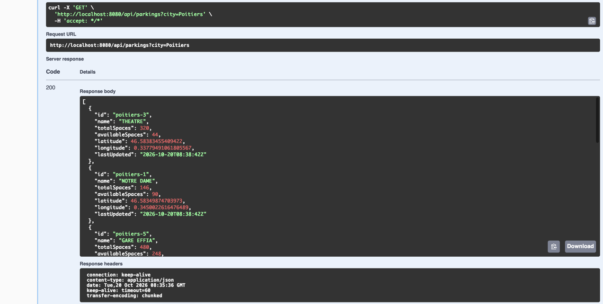
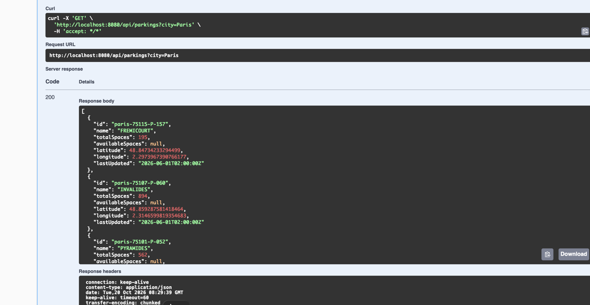

# API de disponibilité des parkings
Une API REST développée avec **Java 21** et **Spring Boot 3.2.2** permettant de récupérer les informations des parkings de différentes villes à travers une interface unifiée.

L’application intègre actuellement deux sources de données publiques :

- **Grand Poitiers :** disponibilité des parkings en temps réel, comprenant la capacité totale et le nombre de places disponibles.
- **Paris Open Data :** informations sur les parkings, notamment leur capacité totale, leur localisation et les dates de mise à jour des données. Ce jeu de données ne fournit pas la disponibilité en temps réel.

Le projet repose sur une architecture extensible permettant d’intégrer de nouvelles villes sans modifier la logique existante du contrôleur ou du service.

## 1. Technologies utilisées

- Java 21
- Spring Boot 3.2.2
- Maven
- Spring Web / RestClient
- Springdoc OpenAPI 3 / Swagger UI
- JUnit 5
- AssertJ
- Jackson

## 2. Fonctionnalités

- Consulter les informations des parkings d’une ville via un endpoint REST unique.
- Récupérer la disponibilité des parkings en temps réel depuis l’API publique de Grand Poitiers.
- Récupérer les informations des parkings depuis l’API Paris Open Data.
- Convertir les réponses des différentes API externes vers un modèle commun `ParkingDto`.
- Valider les coordonnées géographiques avant de les retourner.
- Ajouter de nouvelles villes sans modifier la logique du contrôleur ou du service.
- Gérer les villes non prises en charge et les erreurs provenant des API externes.
- Documenter et tester l’API REST avec Swagger UI.
- Fournir des tests unitaires utilisant des fichiers JSON enregistrés afin de ne pas dépendre des services externes pendant les tests.

## 3. Architecture

L’application suit une architecture en couches et utilise le **patron de conception Strategy (Stratégie)** pour prendre en charge plusieurs fournisseurs de données de stationnement.

```text
ParkingController
       |
       v
ParkingService
       |
       v
ParkingProvider (interface)
       |
       +--------------------------+
       |                          |
       v                          v
PoitiersParkingProvider     ParisParkingProvider
       |                          |
       v                          v
PoitiersParkingMapper       ParisParkingMapper
       |                          |
       +------------+-------------+
                    |
                    v
                ParkingDto
```

### Patron de conception Strategy

L’interface `ParkingProvider` définit le contrat que chaque fournisseur spécifique à une ville doit implémenter :

```java
public interface ParkingProvider {
    String getCity();
    List<ParkingDto> getParkings();
}
```

Chaque fournisseur concret implémente sa propre logique de récupération des informations de stationnement :

- **PoitiersParkingProvider :** se connecte à l’API de stationnement en temps réel de Grand Poitiers.
- **ParisParkingProvider :** se connecte à l’API Paris Open Data.

Spring injecte automatiquement les différentes implémentations de `ParkingProvider` dans `ParkingService`, qui sélectionne le fournisseur approprié en fonction du paramètre `city`.

Cette approche respecte le **principe ouvert/fermé (Open/Closed Principle)** : l’application peut être étendue avec de nouveaux fournisseurs sans modifier le contrôleur ni le service existants.

### Responsabilités des composants

| Composant | Responsabilité |
|---|---|
| `ParkingController` | Expose l’API REST |
| `ParkingService` | Sélectionne le fournisseur correspondant à la ville demandée |
| `ParkingProvider` | Définit le contrat commun des fournisseurs |
| `PoitiersParkingProvider` | Récupère les informations de stationnement en temps réel de Grand Poitiers |
| `PoitiersParkingMapper` | Convertit les données de l’API de Poitiers en `ParkingDto` |
| `ParisParkingProvider` | Récupère les informations des parkings depuis Paris Open Data |
| `ParisParkingMapper` | Convertit les données de l’API de Paris en `ParkingDto` |
| `CoordinateValidator` | Valide les coordonnées géographiques |
| `GlobalExceptionHandler` | Gère les erreurs de l’application et des API externes |

## 4. Sources de données

### Grand Poitiers — API de stationnement en temps réel

L’intégration de Poitiers utilise une API publique fournissant :

- Les identifiants et les noms des parkings
- La capacité totale des parkings
- Le nombre de places actuellement disponibles
- Les coordonnées géographiques
- Les dates de dernière mise à jour

**Endpoint de l’API :**

https://data.grandpoitiers.fr/data-fair/api/v1/datasets/mobilites-stationnement-des-parkings-en-temps-reel/lines

### Paris — API Open Data des parkings

L’intégration de Paris utilise la plateforme officielle Paris Open Data.

**Endpoint de l’API :**

https://opendata.paris.fr/api/explore/v2.1/catalog/datasets/stationnement-en-ouvrage/records?limit=20

Le jeu de données fournit :

- Les identifiants et les noms des parkings
- La capacité totale (`nb_places`)
- Les coordonnées géographiques (`geo_point_2d`)
- Les dates de mise à jour des données (`mis_a_jour`)

**Limitation importante :** ce jeu de données ne fournit pas la disponibilité des parkings en temps réel. Par conséquent, l’API retourne `null` pour le champ `availableSpaces` lorsque la ville demandée est Paris.

Ce comportement est volontaire : `null` signifie que l’information n’est pas disponible, tandis que `0` indiquerait à tort que le parking est complet.

L’endpoint de Paris récupère actuellement jusqu’à 20 enregistrements par requête. Une gestion de la pagination serait nécessaire pour récupérer l’ensemble du jeu de données.

## 5. API REST

### Endpoint

```http
GET /api/parkings?city={city}
```

### Villes prises en charge

| Ville | Source de données | Disponibilité en temps réel |
|---|---|---|
| `poitiers` | Grand Poitiers | Oui |
| `paris` | Paris Open Data | Non |

Les noms des villes ne sont pas sensibles à la casse. Par exemple, `paris` et `Paris` sont tous deux acceptés.

### Exemple : Poitiers

```http
GET http://localhost:8080/api/parkings?city=poitiers
```

Exemple de structure de réponse :

```json
[
  {
    "id": "poitiers-3",
    "name": "THEATRE",
    "totalSpaces": 320,
    "availableSpaces": 99,
    "latitude": 46.58383455409422,
    "longitude": 0.33779491061805567,
    "lastUpdated": "2026-10-19T12:08:17Z"
  }
]
```

Les valeurs sont fournies à titre d’exemple et peuvent évoluer en fonction des données de l’API externe.

### Exemple : Paris

```http
GET http://localhost:8080/api/parkings?city=paris
```

Exemple de structure de réponse :

```json
[
  {
    "id": "paris-75107-P-060",
    "name": "INVALIDES",
    "totalSpaces": 894,
    "availableSpaces": null,
    "latitude": 48.859287581418464,
    "longitude": 2.3146599819354683,
    "lastUpdated": "2026-06-01T02:00:00Z"
  }
]
```

Pour Paris, le champ `lastUpdated` correspond à la date de mise à jour de l’enregistrement dans le jeu de données, et non à une mesure de l’occupation en temps réel.

### Gestion des erreurs

L’application gère les principaux cas d’erreur :

| Code HTTP | Description |
|---|---|
| `200 OK` | Informations des parkings récupérées avec succès |
| `400 Bad Request` | Ville non prise en charge |
| `502 Bad Gateway` | Erreur lors de la récupération ou du traitement des données externes |

## 6. Exécution de l’application

### Prérequis

- Java 21
- Maven
- Une connexion Internet pour récupérer les données des API externes

### Option 1 : Exécution depuis IntelliJ IDEA

1. Ouvrir le projet dans IntelliJ IDEA.
2. Attendre que Maven télécharge et charge les dépendances du projet.
3. Accéder à la classe principale de l’application :

   `src/main/java/org/example/ParkingApplication.java`

4. Ouvrir `ParkingApplication.java`, qui contient le point d’entrée Spring Boot :

   ```java
   package org.example;

   import org.springframework.boot.SpringApplication;
   import org.springframework.boot.autoconfigure.SpringBootApplication;

   @SpringBootApplication
   public class ParkingApplication {

       public static void main(String[] args) {
           SpringApplication.run(ParkingApplication.class, args);
       }
   }
   ```

5. Cliquer sur le bouton vert **Run** à côté de la méthode `main()`.
6. Attendre que l’application démarre correctement.

Par défaut, l’application fonctionne sur le port `8080`.

### Option 2 : Exécution depuis le terminal

Depuis la racine du projet, où se trouve le fichier `pom.xml`, exécuter :

```bash
mvn spring-boot:run
```

Il est également possible de compiler puis d’exécuter l’application avec Maven :

```bash
mvn clean package
java -jar target/*.jar
```

### Accéder à l’API REST

Une fois l’application démarrée, les deux endpoints suivants sont disponibles :

**Poitiers :**

http://localhost:8080/api/parkings?city=poitiers

**Paris :**

http://localhost:8080/api/parkings?city=paris

Exemples avec cURL :

```bash
curl "http://localhost:8080/api/parkings?city=poitiers"
```

```bash
curl "http://localhost:8080/api/parkings?city=paris"
```

## 7. Documentation Swagger UI et OpenAPI

Swagger UI démarre automatiquement avec l’application Spring Boot. Aucun serveur ni commande supplémentaire n’est nécessaire.

**Swagger UI :**

http://localhost:8080/swagger-ui.html

**URL alternative de Swagger UI :**

http://localhost:8080/swagger-ui/index.html

**Documentation OpenAPI 3 au format JSON :**

http://localhost:8080/v3/api-docs

### Tester l’API avec Swagger

1. Démarrer l’application Spring Boot.
2. Ouvrir Swagger UI dans un navigateur.
3. Développer `GET /api/parkings`.
4. Cliquer sur **Try it out**.
5. Saisir `poitiers` ou `paris` dans le paramètre `city`.
6. Cliquer sur **Execute**.
7. Consulter la réponse HTTP et les données retournées par l’API.

Pour Poitiers, la réponse contient le nombre de places disponibles.



Pour Paris, la réponse contient les informations sur la capacité et la localisation des parkings, avec `availableSpaces` défini à `null`.



## 8. Tests

Le projet utilise **JUnit 5**, **AssertJ** et **Jackson**.

Les tests couvrent :

- La conversion des données externes vers `ParkingDto`
- La validation des coordonnées géographiques
- La gestion des coordonnées manquantes ou invalides
- La gestion des dates de mise à jour manquantes
- La désérialisation JSON à partir de réponses API enregistrées
- La conversion des données propres à chaque ville

Les fichiers JSON utilisés pour les tests se trouvent dans :

```text
src/test/resources/parking_json/
├── poitiers-parkings.json
└── paris-parkings.json
```

Ces fichiers permettent de réaliser des tests de désérialisation reproductibles et indépendants de la disponibilité des API externes.

### Exécuter tous les tests

```bash
mvn test
```

## 9. Ajouter une nouvelle ville

L’application est conçue pour faciliter l’intégration de nouvelles villes.

Par exemple, pour ajouter Cannes :

1. Créer une classe `CannesParkingProvider` implémentant l’interface `ParkingProvider`.
2. Créer les modèles correspondant à la structure JSON de l’API externe.
3. Créer un `CannesParkingMapper` pour convertir les données externes en `ParkingDto`.
4. Configurer l’URL de l’API externe dans `application.properties`.
5. Ajouter des tests unitaires pour le fournisseur et le mapper.

Spring détectera automatiquement le nouveau fournisseur grâce à l’injection de dépendances.

Aucune modification de `ParkingController` ou de `ParkingService` ne sera nécessaire.

## 10. Choix techniques et justifications

Plusieurs choix techniques ont été effectués afin de garantir la simplicité, la maintenabilité et l’extensibilité de l’application.

### Java 21 et Spring Boot

Java 21 a été choisi en tant que version LTS (Long-Term Support) moderne de Java, tandis que Spring Boot 3.2.2 fournit un framework fiable pour développer des API REST, avec la prise en charge de l’injection de dépendances et de l’intégration de services externes.

### Patron de conception Strategy

Le patron de conception Strategy a été choisi afin de séparer la logique d’intégration propre à chaque ville du cœur de l’application.

Chaque ville implémente l’interface `ParkingProvider`, tandis que `ParkingService` sélectionne l’implémentation appropriée en fonction de la ville demandée.

Cette approche évite de multiplier les conditions spécifiques à chaque ville et facilite l’extension et les tests de l’application.

### Objet de transfert de données commun (DTO)

Un `ParkingDto` commun a été introduit afin de fournir une structure de réponse API cohérente, quelle que soit la source de données externe.

Chaque fournisseur utilise un mapper dédié pour convertir son format de réponse spécifique vers cette représentation commune.

Cela permet d’isoler les structures des API externes du contrôleur REST.

### Choix de Paris Open Data

L’API Paris Open Data a été sélectionnée car elle constitue une source publique et documentée d’informations sur les parkings.

Bien qu’elle ne fournisse pas la disponibilité en temps réel, son intégration démontre la capacité de l’application à prendre en charge des sources de données hétérogènes sans modifier son architecture principale.

### Gestion des données manquantes

L’API Paris Open Data ne fournit pas la disponibilité des places de stationnement en temps réel.

Plutôt que de retourner une valeur incorrecte, l’application définit le champ `availableSpaces` à `null`, indiquant clairement que cette information n’est pas disponible.

Les coordonnées géographiques sont également validées avant d’être retournées afin d’éviter d’exposer des localisations invalides.

### Stratégie de tests

JUnit 5, AssertJ et Jackson sont utilisés pour vérifier la conversion des données et la désérialisation JSON.

Des réponses JSON enregistrées sont utilisées comme jeux de données de test afin de garantir des tests reproductibles et indépendants de la disponibilité des API externes.

## 11. Considérations professionnelles et améliorations futures

L’implémentation se concentre sur les fonctionnalités principales demandées, tout en identifiant plusieurs améliorations qui pourraient être envisagées dans un environnement de production.

- **Disponibilité en temps réel à Paris :** intégrer un fournisseur de données supplémentaire permettant d’obtenir les informations d’occupation des parkings en temps réel.
- **Pagination :** récupérer l’ensemble des enregistrements disponibles au lieu de limiter la réponse à une seule page.
- **Résilience HTTP :** configurer les délais d’attente de connexion et de réponse, et mettre en place des mécanismes de nouvelle tentative adaptés aux défaillances temporaires des services externes.
- **Mise en cache :** conserver temporairement les réponses des API externes afin de réduire la latence et les appels réseau inutiles.
- **Observabilité :** mettre en place une journalisation structurée, une supervision et des métriques permettant de détecter les défaillances des API externes.
- **Tests supplémentaires :** ajouter des tests d’intégration HTTP et couvrir davantage de cas particuliers, notamment les réponses malformées des API externes.
- **Gestion de la configuration :** externaliser les paramètres propres à chaque environnement afin de faciliter le déploiement de l’application.

Ces améliorations ont été identifiées, mais n’ont pas été implémentées afin de conserver une solution adaptée au périmètre de l’exercice technique.

## 12. Temps consacré à l’exercice

Environ 5 heures au total, réparties comme suit :
- **4 heures:** analyse des exigences, conception de l’architecture, intégration de l’API de Poitiers, tests unitaires et documentation.
- **1 heure:** intégration de l’API Paris Open Data, en réutilisant l’architecture existante basée sur le patron de conception Strategy.

L’ajout de Paris a nécessité relativement peu de modifications grâce à la séparation des responsabilités et à l’architecture extensible mise en place dès le départ.

## 13. Conclusion

Ce projet présente une API REST Spring Boot modulaire qui intègre des données de stationnement provenant de plusieurs sources publiques à travers une interface unifiée.

L’implémentation met l’accent sur la séparation des responsabilités, l’extensibilité, la validation des données d’entrée, la gestion des erreurs et la testabilité.

Les limitations identifiées et les améliorations proposées illustrent la manière dont cette solution pourrait évoluer dans un environnement de production.